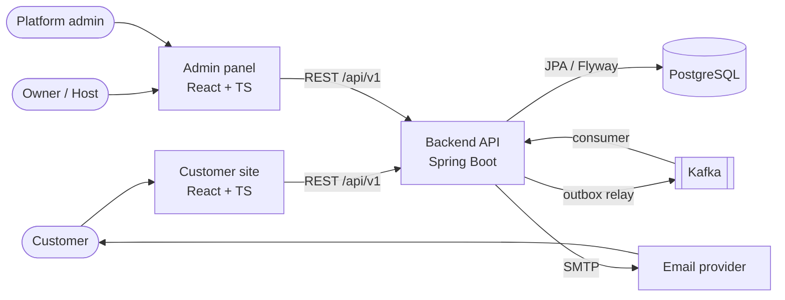

# Architecture

How the platform is built: components, backend modules, the main flows, domain events, security and configuration. Business behaviour is defined in [business-rules.md](business-rules.md); this document explains how it is implemented.

Status markers: ✅ implemented · 🚧 in progress · 📋 planned.

## Contents

- [System context](#system-context)
- [Backend modules](#backend-modules)
- [Main flows](#main-flows)
- [Domain events](#domain-events)
- [Scheduled jobs](#scheduled-jobs)
- [Security](#security)
- [Time handling](#time-handling)
- [Configuration](#configuration)
- [Local development environment](#local-development-environment)
- [Testing strategy](#testing-strategy)

## System context



| Component | Responsibility | Status |
|---|---|---|
| Customer site | Restaurant page, floor plan, booking form, management link pages, booking history. | 📋 |
| Admin panel | Day view, booking list, floor plan editor, settings, staff, audit log. | 📋 |
| Backend API | All business rules, REST API, scheduled jobs, event publishing and the notification consumer. One deployable (modular monolith). | 🚧 |
| PostgreSQL | Source of truth; enforces no double booking with an exclusion constraint. | 🚧 |
| Kafka | Carries domain events. The first consumer is the notification module; later consumers (analytics, integrations) can subscribe without changing the booking code. | 📋 |
| Email provider | Delivers emails (SMTP). Mailpit in local development. | 📋 |

The backend is a single Spring Boot application split into modules with clear boundaries. Splitting into separate services is not planned; Kafka keeps that option open (see [ADR-0003](adr/0003-kafka-for-domain-events.md)).

## Backend modules

Target package layout, organised by feature (each module has its own `controller`, `service`, `repository`, `model` and `dto` sub-packages):

```
br.com.rafael.restaurant_booking
├── restaurant     restaurants, settings, opening hours, closures
├── floorplan      dining areas, tables, table combinations
├── availability   slot and table availability calculation (read-only)
├── booking        booking lifecycle, state machine, staff and customer operations
├── customer       customer records, booking history
├── verification   email codes, booking access tokens
├── notification   Kafka consumer, email templates, delivery tracking
├── auth           staff users, memberships, JWT, refresh tokens, invitations
├── audit          booking history and staff audit log
├── platform       restaurant onboarding (platform admin)
└── shared         errors, outbox, clock, security helpers, config
```

> 🚧 The current code uses layer packages (`model`, `dto`, `controller`, `enums`, `interfaces`). It should move to the layout above as modules are implemented.

Rules between modules:
- Controllers only call services of their own module.
- A module reads another module's data through that module's service, not its repository.
- `booking` is the only module that changes bookings; everything else reacts to its events.

## Main flows

### Online booking and verification

```mermaid
sequenceDiagram
    actor C as Customer
    participant S as Customer site
    participant API as Backend
    participant DB as PostgreSQL
    participant K as Kafka
    participant N as Notification consumer

    C->>S: pick date, party size
    S->>API: GET /restaurants/{slug}/availability/slots
    C->>S: pick time
    S->>API: GET /restaurants/{slug}/availability/tables
    C->>S: pick table, fill in contact
    S->>API: POST /restaurants/{slug}/bookings (Idempotency-Key)
    API->>DB: BEGIN; upsert customer; insert booking (PENDING_VERIFICATION);<br/>insert booking_tables (exclusion constraint);<br/>insert verification code; insert outbox event; COMMIT
    alt table already taken
        DB-->>API: exclusion violation (23P01)
        API-->>S: 409 TABLE_NOT_AVAILABLE
    end
    API-->>S: 201 Created (holdExpiresAt)
    API->>K: outbox relay publishes BookingCreated + verification email request
    K->>N: notification request
    N->>C: email with verification code
    C->>S: enter code
    S->>API: POST /bookings/{id}/verification
    API->>DB: BOOKED; create access token; outbox BookingVerified + email request
    K->>N: notification request (with management link)
    N->>C: booking-received email with management link
```

Key points:
- The exclusion constraint on `booking_tables` is the final guard against double booking; the availability check before it is only for a friendly response.
- The verification code and access token are generated in the transaction and stored hashed. The plain values travel only in a `notification.requests.v1` message so the notification module can email them (see [Topics](#topics)); that outbox row is deleted as soon as it is published.
- `Idempotency-Key` makes retried `POST`s return the first result instead of creating a second booking.

### Reminder, confirmation and auto-cancellation

```mermaid
sequenceDiagram
    participant J as Scheduler
    participant DB as PostgreSQL
    participant K as Kafka
    participant N as Notification consumer
    actor C as Customer

    J->>DB: BOOKED bookings with reminder due, not yet reminded (SKIP LOCKED)
    J->>DB: set reminder_sent_at; outbox BookingReminderDue
    K->>N: BookingReminderDue
    N->>C: reminder email (Confirm / Cancel)
    C->>DB: POST /bookings/{id}/confirm → CONFIRMED
    Note over J,DB: if still BOOKED at the deadline
    J->>DB: AUTO_CANCELLED (NOT_CONFIRMED); release tables; outbox BookingCancelled
    K->>N: BookingCancelled
    N->>C: cancellation email
```

### Availability calculation

For a restaurant, date and party size:

1. Load the restaurant settings, the opening ranges for that weekday and the closures touching that date (cached per restaurant, evicted when the Owner changes them).
2. Generate candidate start times aligned to the slot interval whose `[start, start + duration)` fits in an opening range and no closure (BR-03 to BR-05), and that respect lead time and max advance for online requests (BR-07).
3. Load the active tables and combinations whose capacity fits the party (BR-06, BR-08).
4. Load the blocking `booking_tables` periods for that date (one indexed query).
5. A start time is available if at least one fitting table or combination has no blocked period overlapping `[start, start + duration + buffer)`.

The table view (`/availability/tables`) runs the same steps for one start time and returns every table and combination with a state: `AVAILABLE`, `TOO_SMALL`, `TOO_LARGE`, `TAKEN` or `INACTIVE`.

## Domain events

Events are written to the `outbox_events` table in the same transaction as the change ([transactional outbox](database.md#outbox_events)). A relay reads unpublished rows in order, publishes them to Kafka and marks them published. This guarantees that an event is published if and only if the change was committed. Delivery is at-least-once, so consumers must be idempotent (they track processed `eventId`s).

### Topics

| Topic | Key | Content | Consumers |
|---|---|---|---|
| `booking.events.v1` | booking UUID | Booking facts without secrets | notification module; future analytics/integrations |
| `notification.requests.v1` | recipient email | One-off emails carrying secrets (verification codes, management links, staff invitations, password resets) | notification module only |

Keying by booking UUID keeps all events of one booking in order on one partition. `booking.events.v1` is retained for 30 days; `notification.requests.v1` only for 24 hours, because its messages contain one-time secrets.

### Event envelope

```json
{
  "eventId": "6f1c2d4e-8a7b-4c3d-9e2f-1a2b3c4d5e6f",
  "eventType": "BookingConfirmed",
  "occurredAt": "2026-11-20T12:00:00Z",
  "restaurantId": "c1d2e3f4-...",
  "bookingId": "b1c2d3e4-...",
  "actor": { "type": "CUSTOMER", "userId": null },
  "data": { "status": "CONFIRMED", "startsAt": "2026-11-21T23:00:00Z" }
}
```

### Event types (`booking.events.v1`)

| Event | Emitted when |
|---|---|
| `BookingCreated` | Booking created (any source). |
| `BookingVerified` | `PENDING_VERIFICATION → BOOKED`. |
| `BookingReminderDue` | Reminder job selects the booking. |
| `BookingConfirmed` | `→ CONFIRMED` by the customer. |
| `BookingRescheduled` | Time, tables or party size changed. Includes old and new values. |
| `BookingCancelled` | Any cancellation; `data.status` tells which kind, `data.reason` why. |
| `BookingCheckedIn` | `→ COMPLETED`. |
| `BookingNoShow` | `→ NO_SHOW`. |

## Scheduled jobs

Jobs run every minute on every instance. Each selects due rows with `SELECT … FOR UPDATE SKIP LOCKED` in small batches, so several instances never process the same booking twice.

| Job | Selects | Action | Rule |
|---|---|---|---|
| Hold expiry | `PENDING_VERIFICATION` with `hold_expires_at ≤ now` | → `AUTO_CANCELLED` (`VERIFICATION_EXPIRED`), release tables | BR-30 |
| Reminder | `BOOKED`, `reminder_sent_at IS NULL`, `starts_at − reminder lead ≤ now` | set `reminder_sent_at`, issue a fresh access token, emit `BookingReminderDue` and the reminder email request | BR-33 |
| Auto-cancel | `BOOKED` with `starts_at − confirmation deadline ≤ now` | → `AUTO_CANCELLED` (`NOT_CONFIRMED`), release tables | BR-34 |
| Outbox relay | `outbox_events` with `published_at IS NULL` | publish to Kafka, set `published_at` | — |
| Cleanup | expired codes, tokens and published outbox rows older than 7 days | delete | — |
| Anonymization | customers whose last booking ended more than 24 months ago | replace personal data with placeholders | NFR-07 |

Every job uses an injected `java.time.Clock`, so tests can control time.

## Security

### Staff authentication (JWT)

Decision and alternatives: [ADR-0004](adr/0004-jwt-authentication.md).

| Item | Design |
|---|---|
| Login | `POST /api/v1/auth/login` with email and password. Passwords hashed with Argon2id. |
| Access token | Signed JWT (RS256), valid 15 minutes, sent as `Authorization: Bearer`. Claims: `sub` (user UUID), `platformAdmin`, `iat`, `exp`, `jti`. Validated with Spring Security's OAuth2 resource-server JWT support. |
| Refresh token | Random opaque value, valid 7 days, stored hashed in `refresh_tokens`, sent as an `HttpOnly; Secure; SameSite=Strict` cookie. Rotated on every use; reuse of a rotated token revokes the whole chain. |
| Logout | Revokes the refresh token. Access tokens expire on their own. |
| Authorization | Roles are not stored in the token. On each request to `/admin/restaurants/{restaurantId}/…` the backend loads the user's membership for that restaurant (cached for 1 minute) and checks the required role, so role changes take effect quickly. |
| Lockout | See NFR-06. |

### Customer access

| Mechanism | Used for | Design |
|---|---|---|
| Verification code | Verifying a new booking; history login | 6 digits, stored hashed, 10 min, 5 attempts (BR-16). |
| Booking access token | Management link | 32 random bytes, Base64URL, stored as SHA-256 hash; sent by the frontend as `X-Booking-Token`. Valid until 30 days after the booking start (BR-18). Because only hashes are stored, every email that carries a management link gets a newly issued token; earlier tokens of the same booking stay valid. The link opens a frontend page; the token never appears in API URLs, so it does not leak into server logs. |
| Customer session | Booking history | JWT valid 30 minutes with `sub` = customer UUID and `scope` = `customer`; can only read that customer's bookings (BR-19). |

### Other measures

- Rate limiting per IP and per email/account (NFR-06), implemented in a servlet filter backed by an in-memory bucket per instance, moved to a shared store when running several instances.
- CORS limited to the configured frontend origins.
- Validation of every request body with Bean Validation; unknown JSON properties rejected.
- Personal data (names, emails, phones, tokens, codes) never logged.
- Secrets only from environment variables; `.env` is ignored by Git.

## Time handling

- Every instant is stored as `TIMESTAMPTZ` and handled in Java as `Instant`.
- Rules that depend on the wall clock (opening hours, slot alignment, "same day") are computed with the restaurant's `ZoneId` and `ZonedDateTime`, which handles daylight-saving changes.
- The API accepts and returns RFC 3339 timestamps with an offset; responses use the restaurant's offset so the frontend can display them directly.
- Opening hours are `TIME` values in the restaurant's local time.

## Configuration

| Variable | Example | Purpose |
|---|---|---|
| `DB_URL` | `jdbc:postgresql://localhost:5432/restaurant_booking` | Database URL |
| `DB_USER` / `DB_PASSWORD` | — | Database credentials |
| `KAFKA_BOOTSTRAP_SERVERS` | `localhost:9092` | Kafka brokers |
| `JWT_PRIVATE_KEY` / `JWT_PUBLIC_KEY` | PEM | Signing keys for access tokens and customer sessions |
| `MAIL_HOST` / `MAIL_PORT` / `MAIL_USERNAME` / `MAIL_PASSWORD` | `localhost` / `1025` | SMTP server |
| `MAIL_FROM` | `reservas@example.com` | Sender address |
| `APP_PUBLIC_URL` | `https://reservas.example.com` | Base URL used in email links |
| `CORS_ALLOWED_ORIGINS` | `https://reservas.example.com,https://admin.example.com` | Allowed frontend origins |

## Local development environment

📋 Target `backend/compose.yaml` services (pinned image versions, not `latest`):

| Service | Purpose | Port |
|---|---|---|
| `postgres` | Database `restaurant_booking` | 5432 |
| `kafka` | Single broker in KRaft mode (no ZooKeeper) | 9092 |
| `mailpit` | Catches outgoing emails; web UI to read them | 1025 (SMTP), 8025 (UI) |

Flyway applies the migrations in `backend/src/main/resources/db/migration` on startup.

## Testing strategy

| Level | What | Tools |
|---|---|---|
| Unit | State machine transitions, availability calculation, settings validation, slot alignment around daylight-saving changes | JUnit 5, fixed `Clock` |
| Persistence | Flyway migrations apply cleanly; exclusion constraint rejects overlaps; tenant filters | Testcontainers (PostgreSQL) |
| API | Every endpoint: success, validation errors, authorization per role, cross-restaurant access denied | Spring MockMvc + Testcontainers |
| Messaging | Outbox relay publishes once; consumers are idempotent | Testcontainers (Kafka) |
| Concurrency | Many parallel requests for the same table create exactly one booking | Integration test with a thread pool |
| Performance | NFR-01 targets on availability and booking creation | k6 or Gatling, before each release |
