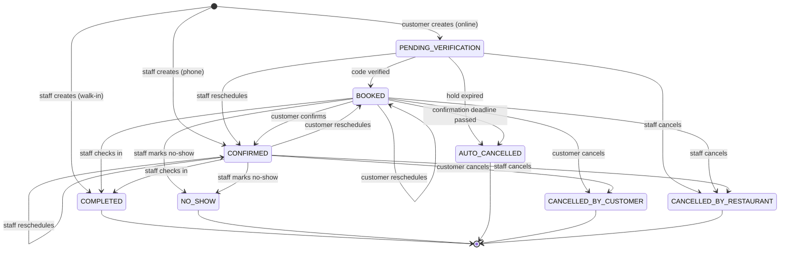

# Business Rules

Requirements and rules for the restaurant table booking platform. Every item has a stable ID: reference it in commits, issues and pull requests (e.g. `Refs: FR-08, BR-12`).

Status markers: ✅ implemented · 🚧 in progress · 📋 planned.

## Contents

- [Scope](#scope)
- [Actors and roles](#actors-and-roles)
- [Restaurant settings](#restaurant-settings)
- [Functional requirements](#functional-requirements)
- [Business rules](#business-rules-1)
- [Booking lifecycle](#booking-lifecycle)
- [Notifications](#notifications)
- [Non-functional requirements](#non-functional-requirements)
- [Open questions](#open-questions)

## Scope

**In scope:** several restaurants on one platform; online booking by customers picking a table on a floor plan; email verification, confirmation and reminders; staff admin panel for tables, opening hours, bookings and staff.

**Out of scope (for now):** payments and deposits, waitlists, SMS/WhatsApp notifications, POS integrations, reviews, customer accounts with passwords.

## Actors and roles

| Actor | Authentication | Can do |
|---|---|---|
| **Customer** | None. Proves control of their email with a one-time code; then uses the management link or a short-lived customer session. | Book, verify, confirm, cancel, reschedule, view their history. |
| **Host** (staff role, per restaurant) | Email + password → JWT | Everything about day-to-day bookings: view, create (phone/walk-in), cancel, reschedule, check in, mark no-show, view statistics. Read-only access to the floor plan and settings. |
| **Owner** (staff role, per restaurant) | Email + password → JWT | Everything a Host can do, plus restaurant settings, opening hours, closures, floor plan, tables, combinations, staff members and the audit log. |
| **Platform admin** | Email + password → JWT | Create and deactivate restaurants and invite their first Owner. Does not manage bookings. |
| **System** | — | Scheduled jobs (hold expiry, reminders, auto-cancellation) and email sending. |

A staff user can be a member of several restaurants, with one role per restaurant.

## Restaurant settings

Each restaurant has its own booking rules. The Owner can change them at any time (FR-21); changes apply to bookings created or rescheduled afterwards, never retroactively.

| Setting | Default | Meaning |
|---|---|---|
| `timeZone` | `America/Sao_Paulo` | Time zone used for opening hours, slots and displayed times. |
| `bookingDurationMinutes` | 120 | How long a booking occupies its table(s). |
| `slotIntervalMinutes` | 30 | Spacing between bookable start times. |
| `turnoverBufferMinutes` | 15 | Extra time the table stays blocked after a booking ends. |
| `minLeadTimeMinutes` | 1440 (24 h) | Minimum time between creating an online booking and its start. |
| `maxAdvanceDays` | 60 | How far in advance customers can book. |
| `maxPartySize` | 12 | Largest party accepted online. |
| `maxActiveBookingsPerCustomer` | 3 | Upcoming online bookings one email can hold at this restaurant. |
| `holdMinutes` | 15 | How long a table is held while waiting for email verification. |
| `reminderLeadMinutes` | 2880 (48 h) | When the reminder is sent, before the booking start. |
| `confirmationDeadlineMinutes` | 720 (12 h) | How long before the start the customer must have confirmed. |
| `noShowGraceMinutes` | 15 | How long after the start staff must wait before marking a no-show. |
| `checkInEarlyMinutes` | 60 | How early before the start a party can be checked in. |

Validation: all values are positive; `confirmationDeadlineMinutes < minLeadTimeMinutes` (otherwise a booking could be born past its deadline) and `confirmationDeadlineMinutes < reminderLeadMinutes`.

## Functional requirements

### Customer

| ID | Requirement | Status |
|---|---|---|
| FR-01 | The customer can view a restaurant's public page: name, address, contact, opening hours and booking rules (max party size, duration). | 📋 |
| FR-02 | The customer can list the available start times for a date and party size. | 📋 |
| FR-03 | The customer can view the floor plan for a chosen start time and party size, showing which tables and combinations are available, too small or taken. | 📋 |
| FR-04 | The customer can create a booking by choosing a start time, party size and **one table or one table combination** on the floor plan, and giving first name, last name, email, phone and optional notes. | 📋 |
| FR-05 | The customer verifies the booking by entering the code sent to their email, and can request a new code. | 📋 |
| FR-06 | After verification the customer receives an email with the booking details and a management link. | 📋 |
| FR-07 | The customer can confirm attendance from the management link (at any time before the confirmation deadline). | 📋 |
| FR-08 | The customer can cancel the booking from the management link until the booking start. | 📋 |
| FR-09 | The customer can reschedule from the management link: change start time, table/combination and party size. | 📋 |
| FR-10 | The customer can view the booking's details and status from the management link. | 📋 |
| FR-11 | The customer can view their past and upcoming bookings across all restaurants after verifying their email with a code. | 📋 |

### Staff (Owner and Host)

| ID | Requirement | Roles | Status |
|---|---|---|---|
| FR-20 | Staff can log in with email and password, refresh the session and log out. | All staff | 📋 |
| FR-21 | Staff can view, and the Owner can edit, the restaurant profile and [settings](#restaurant-settings). | Owner (edit), Host (view) | 📋 |
| FR-22 | The Owner can define weekly opening hours (several ranges per day) and closures (full or partial days). | Owner | 📋 |
| FR-23 | The Owner can create, rename, reorder and delete dining areas. | Owner | 📋 |
| FR-24 | The Owner can create and edit tables: label, area, seats, minimum party size, shape and position on the floor plan. | Owner | 📋 |
| FR-25 | The Owner can deactivate and reactivate tables. | Owner | 🚧 stub entity only |
| FR-26 | The Owner can define table combinations (which tables can be joined and the combined seat count). | Owner | 📋 |
| FR-27 | Staff can list bookings filtered by period, status, area and source, including a day view on the floor plan. | Owner, Host | 📋 |
| FR-28 | Staff can view a booking's details: customer contact, notes, tables and full change history. | Owner, Host | 📋 |
| FR-29 | Staff can create bookings for phone and walk-in customers. | Owner, Host | 📋 |
| FR-30 | Staff can cancel a booking, giving a reason. | Owner, Host | 📋 |
| FR-31 | Staff can reschedule a booking (time, tables, party size). | Owner, Host | 📋 |
| FR-32 | Staff can check a party in and mark a no-show. | Owner, Host | 📋 |
| FR-33 | Staff can view booking statistics for a day or period: totals by status, by source, covers (sum of party sizes) and rescheduled bookings. | Owner, Host | 📋 |
| FR-34 | The Owner can invite staff by email, change their role and remove them from the restaurant. | Owner | 📋 |
| FR-35 | The Owner can view the audit log of staff actions. | Owner | 📋 |
| FR-36 | Staff can reset a forgotten password through an emailed link. | All staff | 📋 |

### Platform admin

| ID | Requirement | Status |
|---|---|---|
| FR-40 | The platform admin can create a restaurant (name, slug, time zone) and invite its first Owner. | 📋 |
| FR-41 | The platform admin can deactivate a restaurant; it then accepts no new bookings and disappears from public listings. | 📋 |

### System

| ID | Requirement | Status |
|---|---|---|
| FR-50 | The system sends the emails listed in [Notifications](#notifications). | 📋 |
| FR-51 | The system releases holds whose verification time expired (BR-30). | 📋 |
| FR-52 | The system sends reminders (BR-33) and auto-cancels unconfirmed bookings at the confirmation deadline (BR-34). | 📋 |
| FR-53 | The system publishes a domain event for every booking change (see [architecture.md](architecture.md#domain-events)). | 📋 |

## Business rules

### Availability

| ID | Rule |
|---|---|
| BR-01 | A booking occupies **exactly one table or one table combination**. |
| BR-02 | A booking occupies its tables during `[start, start + bookingDuration + turnoverBuffer)`. Two bookings that block tables may not overlap on any shared table. This is enforced by the database (see [database.md](database.md#overlap-prevention)), not only by the application. |
| BR-03 | Start times are aligned to the slot interval, counted from midnight in the restaurant's time zone (with 30 min: 19:00, 19:30, 20:00…). |
| BR-04 | The whole booking, `[start, start + bookingDuration)`, must fall inside a single opening range of that day. A range whose closing time is earlier than or equal to its opening time ends on the next day (e.g. 18:00–01:00). |
| BR-05 | No booking may overlap a closure. |
| BR-06 | The party size must be between the table's (or combination's) minimum party size and its seat count. |
| BR-07 | Online bookings must respect `maxPartySize`, `minLeadTimeMinutes` and `maxAdvanceDays`. Staff bookings (phone/walk-in) are exempt from these three limits. |
| BR-08 | Only active tables and active combinations can be booked. A combination is bookable only if all of its tables are active and free. |
| BR-09 | A table cannot be booked individually and as part of a combination at the same time (follows from BR-02: the combination blocks each member table). |
| BR-10 | A customer (by email) may hold at most `maxActiveBookingsPerCustomer` upcoming online bookings at the same restaurant. |

### Customers and identity

| ID | Rule |
|---|---|
| BR-15 | A customer is identified by their email, compared case-insensitively after trimming. The same customer record is shared across restaurants. |
| BR-16 | Every online booking must be verified with a 6-digit code sent to the email given. A code expires after 10 minutes and allows 5 attempts; a new code can be requested once per 60 seconds, at most 5 times per hour per email. |
| BR-17 | The name and phone given are stored on the booking (as they were at booking time) and also update the customer's latest contact data. |
| BR-18 | The management link contains a random token that is valid until 30 days after the booking start. Anyone with the link can manage that one booking, so it is sent only to the verified email. |
| BR-19 | Viewing booking history (FR-11) requires a fresh email code and yields a customer session valid for 30 minutes, limited to that email's bookings. |
| BR-20 | The platform does not collect CPF or any document number. |

### Lifecycle and timing

| ID | Rule |
|---|---|
| BR-30 | A new online booking starts as `PENDING_VERIFICATION` and holds its tables for `holdMinutes`. If not verified in time it becomes `AUTO_CANCELLED` (reason `VERIFICATION_EXPIRED`) and the tables are released. |
| BR-31 | Bookings created by staff skip verification and start as `CONFIRMED` (phone) or `COMPLETED` (walk-in, already seated). Email is optional for them; without email the customer receives no notifications. |
| BR-32 | The customer can confirm a `BOOKED` booking at any time before the confirmation deadline (`start − confirmationDeadlineMinutes`). |
| BR-33 | The reminder is sent at `start − reminderLeadMinutes`. If that moment has already passed when the booking is verified, the booking-received email asks for confirmation and no separate reminder is sent. Confirmed bookings receive no reminder. |
| BR-34 | A booking still `BOOKED` at the confirmation deadline becomes `AUTO_CANCELLED` (reason `NOT_CONFIRMED`) and the customer is emailed. |
| BR-35 | Customers can cancel `BOOKED` or `CONFIRMED` bookings until the start time. |
| BR-36 | Customers can reschedule `BOOKED` or `CONFIRMED` bookings; the new time must satisfy every availability rule, including lead time. The booking returns to `BOOKED` and must be confirmed again. |
| BR-37 | Staff can reschedule `PENDING_VERIFICATION`, `BOOKED` or `CONFIRMED` bookings without the lead-time limit; the booking becomes `CONFIRMED`. |
| BR-38 | A reschedule updates the same booking (same ID and management link), increments its reschedule counter and records the previous values in the booking history. |
| BR-39 | Check-in is possible from `checkInEarlyMinutes` before the start until the booking end. The tables stay blocked until the end of the booking duration plus buffer. |
| BR-40 | A no-show can be marked only after `start + noShowGraceMinutes`. It releases the tables for the rest of the period. |
| BR-41 | Terminal states (`COMPLETED`, `NO_SHOW`, `CANCELLED_BY_CUSTOMER`, `CANCELLED_BY_RESTAURANT`, `AUTO_CANCELLED`) cannot change. |
| BR-42 | Every status change and reschedule is recorded in the booking history with the actor (customer, staff user or system), time and reason. |

### Restaurant administration

| ID | Rule |
|---|---|
| BR-50 | A table or combination with upcoming bookings that block it cannot be deactivated or deleted; staff must first reschedule or cancel those bookings. Tables with past bookings are only deactivated, never deleted. |
| BR-51 | Table labels are unique within a restaurant. Area names are unique within a restaurant. |
| BR-52 | A combination has at least two tables, all from the same restaurant. Its seat count is set by the Owner (joined tables may seat fewer than the sum). |
| BR-53 | Changing opening hours or adding a closure does not cancel existing bookings. The admin panel lists the bookings that now fall outside opening hours so staff can handle them. |
| BR-54 | Each restaurant keeps at least one active Owner. |
| BR-55 | Staff actions on settings, opening hours, closures, areas, tables, combinations and members are recorded in the audit log. |

## Booking lifecycle

| Status | Meaning | Blocks tables? |
|---|---|---|
| `PENDING_VERIFICATION` | Created online, waiting for the email code. | Yes, until the hold expires |
| `BOOKED` | Email verified, attendance not yet confirmed. | Yes |
| `CONFIRMED` | Attendance confirmed by the customer, or created/rescheduled by staff. | Yes |
| `COMPLETED` | Party checked in. | Yes, until booking end + buffer |
| `NO_SHOW` | Party did not arrive. | No |
| `CANCELLED_BY_CUSTOMER` | Cancelled from the management link. | No |
| `CANCELLED_BY_RESTAURANT` | Cancelled by staff (reason required). | No |
| `AUTO_CANCELLED` | Hold expired (`VERIFICATION_EXPIRED`) or not confirmed in time (`NOT_CONFIRMED`). | No |

"Rescheduled" is not a status: it is shown as a badge when the booking's reschedule counter is above zero.

### Timeline example

Default settings, booking created on Monday 10:00 for Thursday 20:00:

| When | What happens |
|---|---|
| Mon 10:00 | Booking created (`PENDING_VERIFICATION`), table held until 10:15, code emailed. |
| Mon 10:03 | Code verified → `BOOKED`; booking-received email with management link. |
| Tue 20:00 | Reminder email (start − 48 h) with a "Confirm" button. |
| Wed 09:00 | Customer confirms → `CONFIRMED`. |
| Thu 08:00 | Confirmation deadline (start − 12 h). Had it still been `BOOKED`, it would become `AUTO_CANCELLED`. |
| Thu 19:00–22:00 | Check-in window. Table blocked 20:00–22:15. |
| Thu 20:15 | From now on staff may mark a no-show. |

## Notifications

All customer notifications are sent by email, in Portuguese, with times in the restaurant's time zone.

| Email | Trigger | Content |
|---|---|---|
| Verification code | Booking created; new code requested; history login | 6-digit code, expiry time |
| Booking received | `PENDING_VERIFICATION → BOOKED` | Details, management link, "Confirm" button if inside the reminder window |
| Reminder | `start − reminderLeadMinutes` for `BOOKED` bookings | Details, "Confirm" and "Cancel" buttons, confirmation deadline |
| Booking confirmed | `BOOKED → CONFIRMED` | Details, management link |
| Booking rescheduled | Any reschedule | Old and new details, whether confirmation is needed again |
| Booking cancelled | Any cancellation (customer, restaurant, automatic) | Reason, link to book again |
| Staff invitation / password reset | FR-34, FR-36, FR-40 | One-time link (valid 48 h / 1 h) |

## Non-functional requirements

| ID | Category | Requirement | Status |
|---|---|---|---|
| NFR-01 | Performance | Public availability and booking endpoints: p95 ≤ 400 ms and p99 ≤ 1 s at 100 requests/s sustained, with 1,000 concurrent users. Admin endpoints: p95 ≤ 800 ms. | 📋 |
| NFR-02 | Availability | 99.5 % monthly uptime for the public API. | 📋 |
| NFR-03 | Scalability | The backend is stateless and can run several instances. Scheduled jobs and event consumers are safe to run on more than one instance. | 📋 |
| NFR-04 | Consistency | Double booking is impossible even under concurrent requests (BR-02 enforced by a database constraint). | 📋 |
| NFR-05 | Security | Staff authenticate with JWT; passwords hashed with Argon2id (or bcrypt); verification codes, management tokens and refresh tokens are stored only as hashes; HTTPS only; CORS limited to the frontend origins. | 📋 |
| NFR-06 | Rate limiting | Public endpoints: 60 requests/min per IP. Code sending: see BR-16. Staff login: 5 failed attempts per 15 min per account and per IP. Exceeding a limit returns `429` with `Retry-After`. | 📋 |
| NFR-07 | Data protection (LGPD) | Collect only name, email, phone and notes. Data encrypted in transit (TLS) and at rest (encrypted storage and backups). No personal data in logs. Customer data is anonymized 24 months after the customer's last booking, or on request. | 📋 |
| NFR-08 | Tenant isolation | Staff only ever see data of restaurants they are members of; every restaurant-owned query is filtered by restaurant. Covered by automated tests. | 📋 |
| NFR-09 | Auditability | Booking history (BR-42) and the staff audit log (BR-55) are kept for at least 5 years and cannot be edited through the application. | 📋 |
| NFR-10 | Backup and recovery | Daily full backups plus point-in-time recovery; 30-day retention; RPO ≤ 15 min, RTO ≤ 4 h. Restores are tested every quarter. | 📋 |
| NFR-11 | Observability | Structured JSON logs with a request ID; health and metrics endpoints (Spring Boot Actuator / Micrometer); alerts on error rate, latency, Kafka consumer lag and failed emails. | 📋 |
| NFR-12 | Email delivery | Emails are sent asynchronously with retries and exponential backoff; 95 % delivered to the provider within 1 minute of the triggering change; sending is idempotent (no duplicates on retry). | 📋 |
| NFR-13 | Accessibility | Customer site and admin panel meet WCAG 2.1 AA. The floor plan is also usable as a keyboard-navigable list of tables. | 📋 |
| NFR-14 | Status colours | Booking states are shown with colour **and** a text label and icon: green = `BOOKED`/`CONFIRMED`, red = cancelled states and `NO_SHOW`, yellow badge = rescheduled, grey = `PENDING_VERIFICATION`, blue = `COMPLETED`. | 📋 |
| NFR-15 | Usability | From the email, a customer cancels in at most 3 clicks (open link → Cancel → confirm). Booking from the restaurant page takes at most 5 steps. The customer site is mobile-first. | 📋 |
| NFR-16 | Localization | UI and emails in Brazilian Portuguese; dates and times always shown in the restaurant's time zone. Code and API in English. | 📋 |
| NFR-17 | Compatibility | Latest two versions of Chrome, Firefox, Safari and Edge, desktop and mobile. | 📋 |
| NFR-18 | Maintainability | Business rules covered by unit tests; API and persistence covered by integration tests against real PostgreSQL and Kafka (Testcontainers); schema changes only through versioned Flyway migrations; OpenAPI spec generated from the code. | 📋 |

## Open questions

Decisions still to be confirmed. Until then the documented default applies.

| # | Question | Current default |
|---|---|---|
| Q-1 | Who creates restaurants: a platform admin, or self-service sign-up by restaurant owners? | Platform admin (FR-40). |
| Q-2 | How long is customer data kept before anonymization? | 24 months after the last booking (NFR-07). |
| Q-3 | Should bookings left in `BOOKED`/`CONFIRMED` after they end be marked `NO_SHOW` automatically when staff forget? | No: staff mark it; the admin panel highlights bookings past their end without check-in. |
| Q-4 | Should a customer be able to cancel after the confirmation deadline, close to the start? | Yes, until the start (BR-35). |
