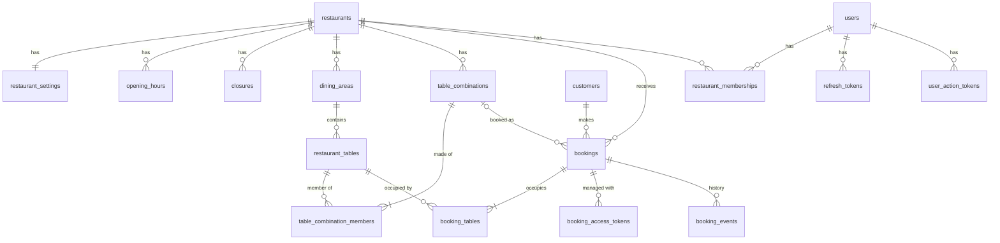

# Database

Target PostgreSQL schema for the platform. It implements the rules in [business-rules.md](business-rules.md); rule IDs are cited where the schema enforces them.

> **Status:** Planned (target design). The current script (`backend/src/main/resources/db/migration/reservation-system.sql`) and the JPA entities implement an earlier, single-restaurant version and will be replaced. See [Current state vs. target](#current-state-vs-target).

## Contents

- [Conventions](#conventions)
- [Entity-relationship overview](#entity-relationship-overview)
- [Tables](#tables)
  - [Restaurants and configuration](#restaurants-and-configuration)
  - [Floor plan](#floor-plan)
  - [Customers and bookings](#customers-and-bookings)
  - [Staff and security](#staff-and-security)
  - [Audit, notifications and events](#audit-notifications-and-events)
- [Overlap prevention](#overlap-prevention)
- [Tenant consistency](#tenant-consistency)
- [Indexes](#indexes)
- [Migrations](#migrations)
- [Current state vs. target](#current-state-vs-target)

## Conventions

| Topic | Convention |
|---|---|
| Version | PostgreSQL 16 or later. |
| Extensions | `citext` (case-insensitive emails), `btree_gist` (exclusion constraint mixing `=` and `&&`). `gen_random_uuid()` is built in; `pgcrypto` is not needed. |
| Names | `snake_case`, plural tables, foreign keys named `<entity>_id`. |
| Primary keys | `id BIGINT GENERATED ALWAYS AS IDENTITY` (internal, never exposed). |
| Public IDs | `uuid UUID NOT NULL UNIQUE DEFAULT gen_random_uuid()` on every entity exposed by the API. |
| Instants | `TIMESTAMPTZ`. Local wall-clock times (opening hours) are `TIME`. |
| Audit columns | `created_at TIMESTAMPTZ NOT NULL DEFAULT now()` and, on mutable tables, `updated_at` maintained by the `set_updated_at()` trigger. |
| Enumerations | `VARCHAR` + `CHECK (col IN (…))`, values identical to the Java enum names (`UPPER_SNAKE_CASE`, no hyphens). |
| Optimistic locking | `version INTEGER NOT NULL DEFAULT 0` on rows edited concurrently (`@Version` in JPA). |
| Deletion | Foreign keys default to `ON DELETE RESTRICT`. Rows with history (tables, bookings, users) are deactivated, never deleted. `ON DELETE CASCADE` only for pure child rows (combination members, booking tables, tokens). |

## Entity-relationship overview



Standalone tables: `verification_codes`, `idempotency_keys`, `audit_log`, `notifications`, `outbox_events`.

## Tables

Columns `id`, `uuid`, `created_at`, `updated_at` and `version` follow the [conventions](#conventions) and are listed only as "standard columns".

### Restaurants and configuration

#### `restaurants`

Standard columns: `id`, `uuid`, `created_at`, `updated_at`, `version`.

| Column | Type | Null | Default | Constraints / notes |
|---|---|---|---|---|
| `slug` | `VARCHAR(80)` | No | — | `UNIQUE`, `CHECK (slug ~ '^[a-z0-9]+(-[a-z0-9]+)*$')` |
| `name` | `VARCHAR(150)` | No | — | |
| `time_zone` | `VARCHAR(64)` | No | `'America/Sao_Paulo'` | IANA zone name; validated by the application |
| `phone` | `VARCHAR(20)` | Yes | — | E.164 |
| `email` | `CITEXT` | Yes | — | Public contact |
| `address_line`, `city`, `state`, `postal_code` | `VARCHAR` | Yes | — | `state` is the 2-letter UF |
| `active` | `BOOLEAN` | No | `TRUE` | FR-41 |

#### `restaurant_settings`

One row per restaurant; meanings and defaults in [business-rules.md → Restaurant settings](business-rules.md#restaurant-settings).

| Column | Type | Default | Constraints |
|---|---|---|---|
| `restaurant_id` | `BIGINT` | — | `PRIMARY KEY`, FK → `restaurants` |
| `booking_duration_minutes` | `INTEGER` | 120 | `> 0` |
| `slot_interval_minutes` | `INTEGER` | 30 | `> 0`, divides 1440 |
| `turnover_buffer_minutes` | `INTEGER` | 15 | `>= 0` |
| `min_lead_time_minutes` | `INTEGER` | 1440 | `>= 0` |
| `max_advance_days` | `INTEGER` | 60 | `> 0` |
| `max_party_size` | `INTEGER` | 12 | `> 0` |
| `max_active_bookings_per_customer` | `INTEGER` | 3 | `> 0` |
| `hold_minutes` | `INTEGER` | 15 | `> 0` |
| `reminder_lead_minutes` | `INTEGER` | 2880 | `> confirmation_deadline_minutes` |
| `confirmation_deadline_minutes` | `INTEGER` | 720 | `>= 0`, `< min_lead_time_minutes` |
| `no_show_grace_minutes` | `INTEGER` | 15 | `>= 0` |
| `check_in_early_minutes` | `INTEGER` | 60 | `>= 0` |
| `updated_at`, `version` | | | standard |

#### `opening_hours`

| Column | Type | Null | Constraints / notes |
|---|---|---|---|
| `id` | `BIGINT` | No | PK |
| `restaurant_id` | `BIGINT` | No | FK → `restaurants` |
| `day_of_week` | `SMALLINT` | No | `CHECK (day_of_week BETWEEN 1 AND 7)`, ISO (1 = Monday) |
| `opens_at` | `TIME` | No | |
| `closes_at` | `TIME` | No | `closes_at <= opens_at` means the range ends the next day (BR-04) |

Overlapping ranges on the same day are rejected by the application. The whole set is replaced on `PUT /opening-hours`.

#### `closures`

| Column | Type | Null | Constraints / notes |
|---|---|---|---|
| `id`, `uuid`, `created_at` | | | standard |
| `restaurant_id` | `BIGINT` | No | FK → `restaurants` |
| `starts_at` | `TIMESTAMPTZ` | No | |
| `ends_at` | `TIMESTAMPTZ` | No | `CHECK (ends_at > starts_at)` |
| `reason` | `VARCHAR(200)` | Yes | Shown to customers |
| `created_by_user_id` | `BIGINT` | No | FK → `users` |

### Floor plan

#### `dining_areas`

| Column | Type | Null | Default | Constraints / notes |
|---|---|---|---|---|
| standard columns | | | | `id`, `uuid`, `created_at`, `updated_at` |
| `restaurant_id` | `BIGINT` | No | — | FK → `restaurants`; `UNIQUE (id, restaurant_id)` for [tenant consistency](#tenant-consistency) |
| `name` | `VARCHAR(60)` | No | — | `UNIQUE (restaurant_id, name)` (BR-51) |
| `is_outdoor` | `BOOLEAN` | No | `FALSE` | |
| `sort_order` | `INTEGER` | No | `0` | |

#### `restaurant_tables`

| Column | Type | Null | Default | Constraints / notes |
|---|---|---|---|---|
| standard columns | | | | `id`, `uuid`, `created_at`, `updated_at`, `version` |
| `restaurant_id` | `BIGINT` | No | — | FK → `restaurants`; `UNIQUE (id, restaurant_id)` |
| `area_id` | `BIGINT` | No | — | FK `(area_id, restaurant_id)` → `dining_areas (id, restaurant_id)` |
| `label` | `VARCHAR(20)` | No | — | `UNIQUE (restaurant_id, label)` (BR-51) |
| `seats` | `INTEGER` | No | — | `CHECK (seats > 0)` |
| `min_party_size` | `INTEGER` | No | `1` | `CHECK (min_party_size BETWEEN 1 AND seats)` (BR-06) |
| `shape` | `VARCHAR(20)` | No | `'SQUARE'` | `CHECK (shape IN ('ROUND', 'SQUARE', 'RECTANGLE'))` |
| `pos_x`, `pos_y` | `INTEGER` | No | — | Floor-plan units, `>= 0` |
| `width`, `height` | `INTEGER` | No | — | `> 0` |
| `rotation` | `SMALLINT` | No | `0` | `CHECK (rotation BETWEEN 0 AND 359)` |
| `active` | `BOOLEAN` | No | `TRUE` | FR-25, BR-50 |

#### `table_combinations`

| Column | Type | Null | Default | Constraints / notes |
|---|---|---|---|---|
| standard columns | | | | `id`, `uuid`, `created_at`, `updated_at`, `version` |
| `restaurant_id` | `BIGINT` | No | — | FK → `restaurants`; `UNIQUE (id, restaurant_id)` |
| `name` | `VARCHAR(60)` | No | — | `UNIQUE (restaurant_id, name)` |
| `seats` | `INTEGER` | No | — | `CHECK (seats > 0)` (BR-52) |
| `min_party_size` | `INTEGER` | No | `1` | `CHECK (min_party_size BETWEEN 1 AND seats)` |
| `active` | `BOOLEAN` | No | `TRUE` | |

#### `table_combination_members`

| Column | Type | Constraints / notes |
|---|---|---|
| `combination_id` | `BIGINT` | FK `(combination_id, restaurant_id)` → `table_combinations`, `ON DELETE CASCADE` |
| `table_id` | `BIGINT` | FK `(table_id, restaurant_id)` → `restaurant_tables` |
| `restaurant_id` | `BIGINT` | Ensures both sides belong to the same restaurant |
| | | `PRIMARY KEY (combination_id, table_id)` |

"At least two members" (BR-52) is checked by the application.

### Customers and bookings

#### `customers`

Shared by all restaurants (BR-15). No CPF or other document is stored (BR-20).

| Column | Type | Null | Default | Constraints / notes |
|---|---|---|---|---|
| standard columns | | | | `id`, `uuid`, `created_at`, `updated_at` |
| `email` | `CITEXT` | Yes | — | `UNIQUE`; stored trimmed. Null only for staff-created bookings without email (BR-31). |
| `first_name` | `VARCHAR(100)` | No | — | Latest value given (BR-17) |
| `last_name` | `VARCHAR(100)` | No | — | |
| `phone` | `VARCHAR(20)` | Yes | — | E.164 |
| `email_verified_at` | `TIMESTAMPTZ` | Yes | — | First successful verification |
| `last_booking_at` | `TIMESTAMPTZ` | Yes | — | Drives anonymization (NFR-07) |
| `anonymized_at` | `TIMESTAMPTZ` | Yes | — | Set when personal data is erased |

#### `bookings`

| Column | Type | Null | Default | Constraints / notes |
|---|---|---|---|---|
| standard columns | | | | `id`, `uuid`, `created_at`, `updated_at`, `version` |
| `restaurant_id` | `BIGINT` | No | — | FK → `restaurants`; `UNIQUE (id, restaurant_id)` |
| `customer_id` | `BIGINT` | No | — | FK → `customers` |
| `combination_id` | `BIGINT` | Yes | — | FK `(combination_id, restaurant_id)` → `table_combinations`; null when a single table is booked (BR-01) |
| `source` | `VARCHAR(10)` | No | `'ONLINE'` | `CHECK (source IN ('ONLINE', 'PHONE', 'WALK_IN'))` |
| `status` | `VARCHAR(30)` | No | — | `CHECK (status IN ('PENDING_VERIFICATION', 'BOOKED', 'CONFIRMED', 'COMPLETED', 'NO_SHOW', 'CANCELLED_BY_CUSTOMER', 'CANCELLED_BY_RESTAURANT', 'AUTO_CANCELLED'))` |
| `party_size` | `INTEGER` | No | — | `CHECK (party_size > 0)` |
| `starts_at` | `TIMESTAMPTZ` | No | — | |
| `ends_at` | `TIMESTAMPTZ` | No | — | `CHECK (ends_at > starts_at)`; `starts_at + duration` at booking time |
| `blocked_until` | `TIMESTAMPTZ` | No | — | `CHECK (blocked_until >= ends_at)`; `ends_at + turnover buffer` |
| `guest_first_name` | `VARCHAR(100)` | No | — | Snapshot (BR-17) |
| `guest_last_name` | `VARCHAR(100)` | No | — | |
| `guest_email` | `CITEXT` | Yes | — | |
| `guest_phone` | `VARCHAR(20)` | Yes | — | |
| `notes` | `VARCHAR(500)` | Yes | — | |
| `reschedule_count` | `INTEGER` | No | `0` | `CHECK (reschedule_count >= 0)` (BR-38) |
| `hold_expires_at` | `TIMESTAMPTZ` | Yes | — | Set while `PENDING_VERIFICATION` (BR-30) |
| `verified_at` | `TIMESTAMPTZ` | Yes | — | |
| `reminder_sent_at` | `TIMESTAMPTZ` | Yes | — | BR-33 |
| `confirmed_at` | `TIMESTAMPTZ` | Yes | — | |
| `checked_in_at` | `TIMESTAMPTZ` | Yes | — | |
| `cancelled_at` | `TIMESTAMPTZ` | Yes | — | |
| `cancel_reason_code` | `VARCHAR(30)` | Yes | — | e.g. `VERIFICATION_EXPIRED`, `NOT_CONFIRMED`, `CUSTOMER_REQUEST`, `RESTAURANT_REQUEST` |
| `cancel_reason_text` | `VARCHAR(500)` | Yes | — | Free text from customer or staff |
| `created_by_user_id` | `BIGINT` | Yes | — | FK → `users`; set for `PHONE`/`WALK_IN` |

Consistency checks: `CHECK ((status = 'PENDING_VERIFICATION') = (hold_expires_at IS NOT NULL))` and `CHECK (status NOT LIKE '%CANCELLED%' OR cancelled_at IS NOT NULL)`. Allowed transitions are enforced by the application's state machine.

#### `booking_tables`

The tables a booking occupies, with the period they are blocked. This is where double booking is prevented.

| Column | Type | Null | Constraints / notes |
|---|---|---|---|
| `booking_id` | `BIGINT` | No | FK `(booking_id, restaurant_id)` → `bookings (id, restaurant_id)`, `ON DELETE CASCADE` |
| `table_id` | `BIGINT` | No | FK `(table_id, restaurant_id)` → `restaurant_tables (id, restaurant_id)` |
| `restaurant_id` | `BIGINT` | No | |
| `period` | `TSTZRANGE` | No | `[starts_at, blocked_until)` of the booking |
| `blocks_table` | `BOOLEAN` | No | `TRUE` for `PENDING_VERIFICATION`, `BOOKED`, `CONFIRMED`, `COMPLETED` |
| | | | `PRIMARY KEY (booking_id, table_id)`; exclusion constraint below |

`period` and `blocks_table` are copied from `bookings` by a trigger on `bookings` (`AFTER INSERT OR UPDATE OF starts_at, blocked_until, status`), so they cannot drift from the booking.

#### `booking_access_tokens`

| Column | Type | Null | Constraints / notes |
|---|---|---|---|
| `id`, `created_at` | | | standard |
| `booking_id` | `BIGINT` | No | FK → `bookings`, `ON DELETE CASCADE` |
| `token_hash` | `BYTEA` | No | `UNIQUE`; SHA-256 of the token (BR-18) |
| `expires_at` | `TIMESTAMPTZ` | No | Booking start + 30 days |
| `revoked_at` | `TIMESTAMPTZ` | Yes | |

#### `verification_codes`

| Column | Type | Null | Constraints / notes |
|---|---|---|---|
| `id`, `created_at` | | | standard |
| `purpose` | `VARCHAR(20)` | No | `CHECK (purpose IN ('BOOKING', 'HISTORY_LOGIN'))` |
| `email` | `CITEXT` | No | |
| `booking_id` | `BIGINT` | Yes | FK → `bookings`; required when `purpose = 'BOOKING'` |
| `code_hash` | `BYTEA` | No | |
| `expires_at` | `TIMESTAMPTZ` | No | `created_at + 10 min` (BR-16) |
| `attempts` | `SMALLINT` | No | default `0`, `CHECK (attempts <= 5)` |
| `consumed_at` | `TIMESTAMPTZ` | Yes | |

#### `booking_events`

Immutable booking history (BR-42). The application only inserts.

| Column | Type | Null | Constraints / notes |
|---|---|---|---|
| `id`, `created_at` | | | standard |
| `booking_id` | `BIGINT` | No | FK → `bookings` |
| `event_type` | `VARCHAR(30)` | No | Same names as the [domain events](architecture.md#event-types-bookingeventsv1) |
| `from_status`, `to_status` | `VARCHAR(30)` | Yes | |
| `changes` | `JSONB` | Yes | Old and new values for reschedules (`startsAt`, `partySize`, `tableIds`) |
| `actor_type` | `VARCHAR(10)` | No | `CHECK (actor_type IN ('CUSTOMER', 'STAFF', 'SYSTEM'))` |
| `actor_user_id` | `BIGINT` | Yes | FK → `users`; required when `actor_type = 'STAFF'` |
| `reason` | `VARCHAR(500)` | Yes | |

#### `idempotency_keys`

| Column | Type | Null | Constraints / notes |
|---|---|---|---|
| `key` | `UUID` | No | `PRIMARY KEY (key, endpoint)` |
| `endpoint` | `VARCHAR(100)` | No | |
| `request_hash` | `BYTEA` | No | Same key with a different body → `422` |
| `response_status` | `SMALLINT` | No | |
| `response_body` | `JSONB` | No | |
| `created_at` | `TIMESTAMPTZ` | No | Rows older than 24 h are deleted |

### Staff and security

#### `users`

Staff accounts only; customers have no password.

| Column | Type | Null | Default | Constraints / notes |
|---|---|---|---|---|
| standard columns | | | | `id`, `uuid`, `created_at`, `updated_at`, `version` |
| `email` | `CITEXT` | No | — | `UNIQUE` |
| `password_hash` | `VARCHAR(255)` | Yes | — | Argon2id encoded string; null until the invitation is accepted |
| `first_name` | `VARCHAR(100)` | No | — | |
| `last_name` | `VARCHAR(100)` | No | — | |
| `is_platform_admin` | `BOOLEAN` | No | `FALSE` | |
| `active` | `BOOLEAN` | No | `TRUE` | |
| `failed_login_count` | `SMALLINT` | No | `0` | NFR-06 |
| `locked_until` | `TIMESTAMPTZ` | Yes | — | |
| `last_login_at` | `TIMESTAMPTZ` | Yes | — | |

#### `restaurant_memberships`

| Column | Type | Null | Constraints / notes |
|---|---|---|---|
| `user_id` | `BIGINT` | No | FK → `users` |
| `restaurant_id` | `BIGINT` | No | FK → `restaurants` |
| `role` | `VARCHAR(10)` | No | `CHECK (role IN ('OWNER', 'HOST'))` |
| `created_at` | `TIMESTAMPTZ` | No | |
| | | | `PRIMARY KEY (user_id, restaurant_id)` |

"At least one active Owner per restaurant" (BR-54) is checked by the application inside the same transaction, with the restaurant row locked.

#### `refresh_tokens`

| Column | Type | Null | Constraints / notes |
|---|---|---|---|
| `id`, `created_at` | | | standard |
| `user_id` | `BIGINT` | No | FK → `users`, `ON DELETE CASCADE` |
| `token_hash` | `BYTEA` | No | `UNIQUE` |
| `family_id` | `UUID` | No | Chain of rotated tokens; reuse revokes the family |
| `expires_at` | `TIMESTAMPTZ` | No | 7 days |
| `revoked_at` | `TIMESTAMPTZ` | Yes | |
| `replaced_by_id` | `BIGINT` | Yes | FK → `refresh_tokens` |

#### `user_action_tokens`

Invitations and password resets (FR-34, FR-36, FR-40).

| Column | Type | Null | Constraints / notes |
|---|---|---|---|
| `id`, `created_at` | | | standard |
| `user_id` | `BIGINT` | No | FK → `users`, `ON DELETE CASCADE` |
| `purpose` | `VARCHAR(20)` | No | `CHECK (purpose IN ('INVITATION', 'PASSWORD_RESET'))` |
| `token_hash` | `BYTEA` | No | `UNIQUE` |
| `expires_at` | `TIMESTAMPTZ` | No | 48 h (invitation) / 1 h (reset) |
| `consumed_at` | `TIMESTAMPTZ` | Yes | |

### Audit, notifications and events

#### `audit_log`

Staff actions on everything except bookings (bookings use `booking_events`). Insert-only (BR-55, NFR-09).

| Column | Type | Null | Constraints / notes |
|---|---|---|---|
| `id`, `created_at` | | | standard |
| `restaurant_id` | `BIGINT` | Yes | FK → `restaurants`; null for platform-level actions |
| `actor_user_id` | `BIGINT` | No | FK → `users` |
| `action` | `VARCHAR(40)` | No | e.g. `TABLE_CREATED`, `SETTINGS_UPDATED`, `MEMBER_ROLE_CHANGED` |
| `entity_type` | `VARCHAR(40)` | No | |
| `entity_uuid` | `UUID` | Yes | |
| `changes` | `JSONB` | Yes | `{ "field": { "old": …, "new": … } }`; never contains passwords or tokens |

#### `notifications`

One row per email, used for idempotency and delivery tracking (NFR-12).

| Column | Type | Null | Constraints / notes |
|---|---|---|---|
| `id`, `uuid`, `created_at` | | | standard |
| `source_event_id` | `UUID` | No | `UNIQUE (source_event_id, type)`: an event never produces the same email twice |
| `booking_id` | `BIGINT` | Yes | FK → `bookings` |
| `type` | `VARCHAR(40)` | No | e.g. `VERIFICATION_CODE`, `BOOKING_RECEIVED`, `REMINDER`, `BOOKING_CANCELLED` |
| `recipient` | `CITEXT` | No | |
| `status` | `VARCHAR(10)` | No | `CHECK (status IN ('PENDING', 'SENT', 'FAILED'))` |
| `attempts` | `SMALLINT` | No | default `0` |
| `next_attempt_at` | `TIMESTAMPTZ` | Yes | Exponential backoff |
| `last_error` | `VARCHAR(500)` | Yes | |
| `sent_at` | `TIMESTAMPTZ` | Yes | |

#### `outbox_events`

Transactional outbox ([architecture.md → Domain events](architecture.md#domain-events)).

| Column | Type | Null | Constraints / notes |
|---|---|---|---|
| `id` | `UUID` | No | `PRIMARY KEY`; becomes the `eventId` |
| `sequence` | `BIGINT` | No | `GENERATED ALWAYS AS IDENTITY`; publication order |
| `topic` | `VARCHAR(100)` | No | |
| `message_key` | `VARCHAR(100)` | No | |
| `event_type` | `VARCHAR(50)` | No | |
| `payload` | `JSONB` | No | |
| `created_at` | `TIMESTAMPTZ` | No | |
| `published_at` | `TIMESTAMPTZ` | Yes | Rows of `notification.requests.v1` are deleted right after publishing |

## Overlap prevention

BR-02 is enforced by an exclusion constraint, so two concurrent transactions can never both book the same table for overlapping periods:

```sql
CREATE EXTENSION IF NOT EXISTS btree_gist;

ALTER TABLE booking_tables
    ADD CONSTRAINT booking_tables_no_overlap
    EXCLUDE USING gist (table_id WITH =, period WITH &&)
    WHERE (blocks_table);
```

- `period` is half-open (`[start, blocked_until)`), so a booking ending at 21:45 does not conflict with one starting at 21:45.
- Bookings that do not block (cancelled, no-show) are ignored by the `WHERE` clause, which also makes rebooking a freed table possible.
- A violation raises SQLSTATE `23P01`; the backend maps it to `409 TABLE_NOT_AVAILABLE`.
- A combination booking inserts one row per member table, so a table cannot be booked alone and inside a combination at the same time (BR-09).
- Expired holds keep blocking until the hold-expiry job runs (at most about a minute later).

## Tenant consistency

Every restaurant-owned table has `restaurant_id` and `UNIQUE (id, restaurant_id)`. Child rows reference parents with **composite** foreign keys that include `restaurant_id` (e.g. `booking_tables (table_id, restaurant_id) → restaurant_tables (id, restaurant_id)`). The database therefore rejects a booking that points to another restaurant's table, even if the application has a bug (NFR-08).

## Indexes

Beyond those created by primary keys and unique constraints:

| Table | Index | Used by |
|---|---|---|
| `bookings` | `(restaurant_id, starts_at)` | Admin lists, stats, availability |
| `bookings` | `(customer_id, starts_at DESC)` | Customer history, active booking limit |
| `bookings` | `(hold_expires_at) WHERE status = 'PENDING_VERIFICATION'` | Hold-expiry job |
| `bookings` | `(starts_at) WHERE status = 'BOOKED'` | Reminder and auto-cancel jobs |
| `booking_tables` | GiST from the exclusion constraint | Overlap check and availability |
| `booking_tables` | `(restaurant_id)` | Availability per restaurant |
| `booking_events` | `(booking_id, created_at)` | Booking history |
| `opening_hours` | `(restaurant_id, day_of_week)` | Availability |
| `closures` | GiST on `(restaurant_id, tstzrange(starts_at, ends_at))` | Availability |
| `restaurant_tables` | `(restaurant_id) WHERE active` | Floor plan |
| `verification_codes` | `(email, created_at DESC)` | Code checks and rate limiting |
| `notifications` | `(next_attempt_at) WHERE status = 'PENDING'` | Retry job |
| `outbox_events` | `(sequence) WHERE published_at IS NULL` | Outbox relay |
| `audit_log` | `(restaurant_id, created_at DESC)` | Audit log view |
| All foreign keys | One index per FK column not already covered | Joins and `RESTRICT` checks |

## Migrations

- Flyway runs on application startup from `backend/src/main/resources/db/migration`.
- File names: `V<number>__<description>.sql`, e.g. `V1__create_extensions.sql`, `V2__create_restaurants.sql`. Applied migrations are never edited; changes go in a new file.
- Migrations do **not** create or drop the database or connect with `\c`. The database and its owner are created by the environment (Docker Compose, managed service).
- No `LC_COLLATE`/`LC_CTYPE` tied to an OS locale: the default (or an ICU collation such as `und-x-icu`) works on any server image.
- JPA runs with `spring.jpa.hibernate.ddl-auto=validate`, so entities must match the migrations exactly; the persistence tests catch mismatches.

## Current state vs. target

The database is being rewritten. These are the differences between what is in the repository today and this design, so nothing is lost in the rewrite.

### Schema (`reservation-system.sql`)

| Current | Target | Note |
|---|---|---|
| Not a Flyway migration (wrong file name; `DROP/CREATE DATABASE`, `\c`, `pt_BR.UTF-8` locale) | Versioned `V<n>__*.sql` files | Flyway ignores the current file. |
| Single restaurant | `restaurants` + `restaurant_id` everywhere | [ADR-0001](adr/0001-multi-restaurant-tenancy.md) |
| `SERIAL` / `BIGSERIAL` | `BIGINT GENERATED ALWAYS AS IDENTITY` | |
| `restaurant_tables` without `created_at`/`updated_at` | Standard audit columns | The current `TableModel` maps them, so Hibernate validation fails at startup. |
| `table_status` `AVAILABLE`/`NOT-AVAILABLE` | `active BOOLEAN` | The hyphen did not match the Java enum `NOT_AVAILABLE`; availability is computed, not stored. |
| `table_location` `INTERIOR`/`EXTERIOR` | `dining_areas` with `is_outdoor` | Restaurants have more than two areas. |
| No table label or position | `label`, `shape`, `pos_x`, `pos_y`, `width`, `height`, `rotation` | Needed for the seat map. |
| `booking_tables_customers` with `fk_customer_id` | `booking_tables` with `period` and `blocks_table` | The customer column duplicated `bookings.customer_id`. |
| `bookings.booking_datetime` only | `starts_at`, `ends_at`, `blocked_until` | Overlaps could not be detected without an end. |
| Status `ACTIVE`/`CANCELLED`/`RESCHEDULED` + `confirmed` boolean | 8-state lifecycle, `reschedule_count` | [Booking lifecycle](business-rules.md#booking-lifecycle) |
| `customers.cpf`, `is_phone_verified`, `is_email_verified` | Removed; `email_verified_at` | BR-20, [ADR-0005](adr/0005-email-identity-and-data-minimization.md) |
| `customers.email VARCHAR UNIQUE` | `CITEXT UNIQUE` | Case-insensitive uniqueness. |
| `users` without roles | `restaurant_memberships`, `is_platform_admin` | |
| `pgcrypto` extension | `citext`, `btree_gist` | `gen_random_uuid()` is built in since PostgreSQL 13. |
| `updated_at` never updated | `set_updated_at()` trigger | |

### Backend entities and configuration

| Current | Target |
|---|---|
| `ReservationModel` → table `bookings` | `BookingModel` (one name for the concept, see [glossary](glossary.md#naming-conventions)) |
| `BookingTableModel` / `BookingTableId` with customer | Maps `booking_tables` without customer |
| `TableModel.id` is `Integer` | `Long`, like every other ID |
| `TableStatus`, `TableLocation` enums | `active` flag and `DiningAreaModel` |
| `BookingStatus` with 3 values | 8 values of the new lifecycle |
| `CustomerModel.cpf`, verification flags; `CustomerDTO` exposes CPF | Removed |
| `compose.yaml`: database `mydatabase`, user `myuser`, `postgres:latest`, RabbitMQ | Database `restaurant_booking`, pinned versions, Kafka and Mailpit instead of RabbitMQ |
